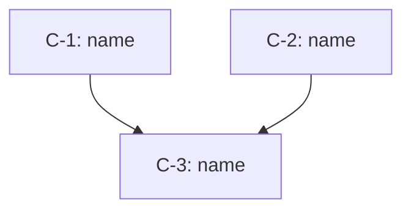

<!--
Output format for the ultra tier. The process that fills this in is
common/ultra.md.

Written to the project's drafts directory (`docs/drafts/` unless the project
uses another) as `<name>-spec.md`. This markdown file is the deliverable: it
is what the PR reviews, what the epic records the path of, and what the
milestone build plans from. It is authoritative.

The document the user reads and reviews is an Artifact published from this
file — see ultra.md. The Artifact is a view, always regenerated from this
markdown and never edited on its own.

One document, three parts, in the order they get produced: the strategy as
prose, the system map as a diagram, then one section per component carrying
its contract. The map is what the user thinks with; the contracts fall out of
it.

A component is a part of the finished system with one responsibility. Its
section must let a reader answer four things: what it owns, what it does when
it is live, which components it consumes, and how it is proven. A component
does not have to be user-facing: shared infrastructure other components ride
on is a component in its own right.

The spec describes the end state, never the route. The milestone build plans
the route — runnable slices that cut across components — from these sections,
so nothing here orders work into phases.

**Components are one flat level.** Group them in the narrative however the
design reads — a heading and a paragraph saying what the group is for — but a
grouping is never a component: no `Needs` line, and its heading is never
`## C-N:`. Every id is `C-` and one plain number: no prefix for foundation
work, no decimal for a member of a group.

The `## C-N:` headings, the `Owns:` and `Needs:` lines, and the Tests block
are the machine surface: the milestone build's gather and coverage table read
them. Keep them exactly as shaped here. Everything else is open.

An id is permanent once assigned: a component added later takes the next free
number wherever it sits, and nothing already written is renumbered around it.

The diagram is a mermaid fence. Lay the nodes out by dependency depth:
everything that needs nothing on the top row, and each component one row below
the deepest thing it needs.
-->

# <SPEC NAME>

## Context

<!--
Why this spec exists, and why now. If it follows a failure, what the failure
was and what it cost, in the plainest terms available — lessons learned
belong here as prose, not as a numbered rule list. A reader who has never
seen the system should finish this section knowing what is being built.
-->

## System map

<!--
The components and the edges between them. An arrow runs from a component to
each one that needs it, so the graph flows downward in the order things get
built, and reading it top to bottom is the build narrative — the same thing
the user walks when they test the branch before merging.

Every node here has a section below, and every name on a component's
`Needs` line is one arrow into it — including a need another path already
implies, so the drawing and the sections can be checked against each other
mechanically. When one changes, change the other in the same edit.
-->

## C-1: <name>

**Owns:** <the one thing this component is sole author of>
**Needs:** <C-x, C-y | none>

<!--
**Owns** is what keeps two components off the same ground. Name the
responsibility this component is the sole author of, in the system's terms
rather than the code's. Two components that build at the same time must own
disjoint things — if you cannot say what this one owns without naming
something another owns, they are one component, or one needs the other.
Overlap is never fully avoidable, but two components answering to different
responsibilities rarely touch the same ground, and two inside one
responsibility almost always do.

**Needs** names the components this one consumes. The why — what it cannot
do without them — goes in the body. The build orders its milestones by these
edges, so an edge you did not declare is a milestone planned on ground that is
not there yet.

Free-form body, end to end: a reader should be able to follow the component
the way the live system executes it. Where it bets on a premise about the
world, state in prose the observation that would prove the premise wrong.

Never how it is built. Naming a file, class, function, library, or ticket
key is the obvious version, but the line is wider than code nouns: a storage
shape, a data structure, an ordering, a concurrency model usually smuggle it
in too. None of those words is banned on sight — the test is the rule, and
the list is only where it most often trips: could two competent teams build
your sentence differently and both be right? If it rules one of them out
without a behavioral reason, it belongs in the run's plan, not here.

One exception: a named established mechanism the spec deliberately adopts —
the named equivalent that ultra's precedent research hunts down — is a
decision, not an implementation detail. Name it and say what it buys;
inheriting its literature is the whole point of naming it.

Unresolved items sit inline where they belong, in the markup below. The task
tracker is the index — no rollup section here.
-->

> **Open question:** undecided, needs the user's call.

> **Post-deploy:** cannot be decided until the spec is live and real traffic
> answers it. Ships as a follow-up ticket, never as a blocker.

### Tests

<!--
Last thing in every component: how it is exercised end to end, then one
named scenario per edge case. The body's rule holds here too — a scenario
says what is observed, never how the code makes it so. Surviving findings
from the adversarial gate land here. It is the longest part by far, and
every scenario carries its reasoning — a named bullet with a sentence
behind it, never a bare list of labels.
-->

<!--
Repeat the component section for as many components as the design has. Order
them the way the system reads, not the way they build — the milestone plan
carries the build order.
-->
